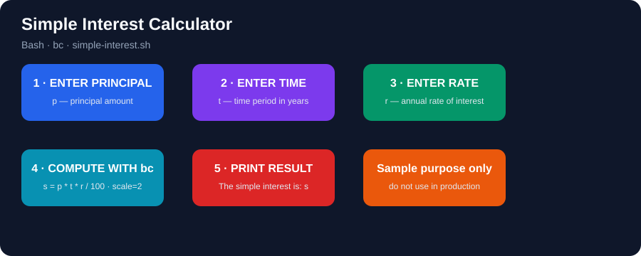

<div align="center">

# 💰 Simple Interest Calculator

**A calculator that calculates simple interest given principal, annual rate of interest and time period in years.**


*IBM Introduction to Git and GitHub · Coursera · Bash*

</div>

---

## 🎯 What this does

A small Bash script, `simple-interest.sh`, that asks for three numbers and prints the simple interest on them:

> **simple interest = p × t × r / 100**

- **p** — principal amount
- **t** — time period in years
- **r** — annual rate of interest

The result is calculated with `bc` to 2 decimal places. Sample purpose only — do not use this in production.

## 🖼️ How it works




📸 **Screenshots:** the diagram above is the visual reference for this repo. No screenshots exist — a real terminal screenshot of a run can be added later at `docs/screenshots/run.png`. No fake screenshots are included.

## ⚡ How to run

```bash
chmod +x simple-interest.sh
./simple-interest.sh
```

The script prompts for the three inputs, one at a time:

```text
Enter the principal:
1000
Enter time period in years:
2
Enter rate of interest per year:
5
The simple interest is:
100.00
```

Requirements: `bash` and `bc` (both standard on Linux/macOS).

## 📂 Project layout

```
.
├── simple-interest.sh      # the calculator — prompts, computes with bc, prints result
├── README.md
├── CONTRIBUTING.md         # contributions, bug reports and ideas are welcome
├── CODE_OF_CONDUCT.md      # Contributor Covenant Code of Conduct
├── LICENSE                 # Apache License 2.0
└── docs/
    └── architecture.svg    # input → compute → output flow
```

## 🤝 Contributing

All contributions, bug reports, bug fixes, documentation improvements, enhancements, and ideas are welcome — see [CONTRIBUTING.md](CONTRIBUTING.md).

## 👥 Authors

- **Upkar Lidder (IBM)** — original script author
- **abdullacaad** — additional author

## 📄 License

Apache License 2.0 — see [LICENSE](LICENSE).
